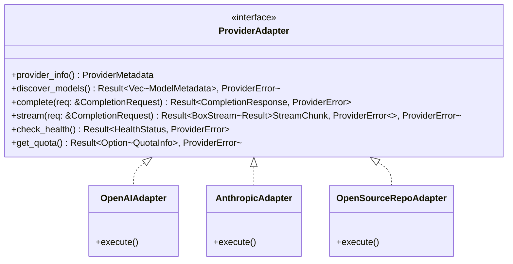

# PROVIDER_INTEGRATION.md — Provider Adapter Framework & Integration Guide

**Project:** `ai-backend` (High-Performance, Security-Focused Rust AI Backend)  
**Governing Specification:** [`MASTER_SPEC.md`](file:///d:/Rust%20Backend/ai-backend/MASTER_SPEC.md)  
**Status:** Complete Adapter Contract & Onboarding Specification (Pre-Implementation Baseline)  
**Last Updated:** 2026-10-19

---

## 1. Provider Adapter Architecture

The backend isolates all vendor-specific protocols, payload formatting, authentication mechanisms, and streaming oddities behind a standardized, asynchronous Rust trait: `ProviderAdapter`.

Adding a new provider (or integrating an independently maintained GitHub repository) requires only implementing this trait, writing contract tests, and registering the adapter in the central provider registry. Core routing, error handling, and client APIs remain untouched.



---

## 2. Standardized Rust Trait & Core Types (Proposed Contract)

```rust
use async_trait::async_trait;
use futures::stream::BoxStream;
use serde::{Deserialize, Serialize};
use std::time::Duration;

/// Normalized metadata describing an integrated AI provider.
#[derive(Debug, Clone, Serialize, Deserialize)]
pub struct ProviderMetadata {
    pub provider_id: String,
    pub display_name: String,
    pub base_url: String,
    pub rate_limit_tier: String,
    pub is_enabled: bool,
}

/// Normalized model capabilities declared by an adapter.
#[derive(Debug, Clone, Serialize, Deserialize)]
pub struct ModelMetadata {
    pub model_id: String,
    pub provider_id: String,
    pub display_name: String,
    pub supported_modalities: Vec<String>, // "text", "code", "image", "doc"
    pub context_window: usize,
    pub max_output_tokens: usize,
    pub streaming_supported: bool,
    pub tool_calling_supported: bool,
    pub speed_tier: String, // "fast", "balanced", "advanced"
    pub cost_tier: String,  // "free-tier", "low-cost", "premium"
    pub is_available: bool,
}

/// Canonical completion request passed to adapters.
#[derive(Debug, Clone, Serialize, Deserialize)]
pub struct CompletionRequest {
    pub model_id: String,
    pub messages: Vec<CanonicalMessage>,
    pub temperature: Option<f32>,
    pub max_tokens: Option<usize>,
    pub timeout: Duration,
}

#[derive(Debug, Clone, Serialize, Deserialize)]
pub struct CanonicalMessage {
    pub role: String, // "system", "user", "assistant"
    pub content: String,
}

/// Normalized completion output.
#[derive(Debug, Clone, Serialize, Deserialize)]
pub struct CompletionResponse {
    pub text: String,
    pub model_used: String,
    pub usage: Option<NormalizedUsage>,
}

#[derive(Debug, Clone, Serialize, Deserialize)]
pub struct StreamChunk {
    pub delta: String,
    pub is_done: bool,
    pub usage: Option<NormalizedUsage>,
}

#[derive(Debug, Clone, Serialize, Deserialize)]
pub struct NormalizedUsage {
    pub prompt_tokens: usize,
    pub completion_tokens: usize,
    pub total_tokens: usize,
    pub is_estimated: bool,
}

/// Normalized provider error enum.
#[derive(Debug, thiserror::Error)]
pub enum ProviderError {
    #[error("Authentication failed: {0}")]
    AuthenticationFailed(String),

    #[error("Rate limited: retry after {retry_after_secs:?} seconds")]
    RateLimited { retry_after_secs: Option<u64> },

    #[error("Quota exhausted for provider {0}")]
    QuotaExhausted(String),

    #[error("Request timed out after {0:?}")]
    Timeout(Duration),

    #[error("Network connection failure: {0}")]
    NetworkFailure(String),

    #[error("Invalid request payload: {0}")]
    InvalidRequest(String),

    #[error("Upstream server error (status {status_code}): {message}")]
    UpstreamError { status_code: u16, message: String },

    #[error("Requested capability is unsupported by model {0}")]
    CapabilityMismatch(String),
}

/// Primary asynchronous trait implemented by all provider adapters.
#[async_trait]
pub trait ProviderAdapter: Send + Sync {
    /// Return static identification metadata for this provider.
    fn provider_info(&self) -> ProviderMetadata;

    /// Discover or return statically registered models supported by this adapter.
    async fn discover_models(&self) -> Result<Vec<ModelMetadata>, ProviderError>;

    /// Execute a standard buffered chat completion.
    async fn complete(&self, req: &CompletionRequest) -> Result<CompletionResponse, ProviderError>;

    /// Execute a streaming chat completion yielding incremental chunks.
    async fn stream(
        &self,
        req: &CompletionRequest,
    ) -> Result<BoxStream<'static, Result<StreamChunk, ProviderError>>, ProviderError>;

    /// Check health and operational reachability of the provider endpoint.
    async fn check_health(&self) -> Result<bool, ProviderError>;
}
```

---

## 3. Provider Onboarding & Verification Checklist

Before integrating any external AI provider or open-source GitHub repository adapter, complete this mandatory 12-step verification:

1. **License & Terms Verification:** Verify that the repository has a permissive open-source license (MIT, Apache 2.0, BSD) and that the provider's Terms of Service permit programmatic aggregation and multi-client routing.
2. **Provenance & Maintainer Review:** Confirm the repository is maintained by a trusted entity. Distinguish official upstream API endpoints from third-party proxies or personal mirrors.
3. **Endpoint Security & Allowlisting:** Validate that all outbound URLs point strictly to official HTTPS domain names. Add these domains to the backend's SSRF egress allowlist.
4. **Authentication & Secret Isolation:** Confirm that credentials are provided via server-side environment variables and never logged or exposed to frontends.
5. **Model & Modality Verification:** Test each advertised model to ensure claimed capabilities (e.g., coding, vision, tool use) exist and function correctly. Never fabricate capabilities.
6. **Token & Quota Claim Audit:** Audit advertised "free token" claims. If a provider does not expose a real remaining-quota API, mark quota information as `unknown_provider_reported` rather than inventing counters.
7. **Streaming & Protocol Support:** Verify that the provider supports standard Server-Sent Events (SSE) or chunked transfer, and correctly handles abrupt client disconnects.
8. **Timeout & Deadline Compliance:** Enforce strict client timeouts (e.g. 10s default) on external calls to prevent hanging serverless microVMs.
9. **Error Code Normalization:** Ensure all HTTP error responses (401, 403, 404, 429, 500, 502, 503) map to the appropriate `ProviderError` variants.
10. **Immutable Commit Pinning:** If integrating external library code or git submodules, pin strictly to explicit commit hashes or immutable release tags.
11. **Contract & Mock Tests:** Implement a Wiremock-based test suite verifying completion, streaming, rate limiting, and failure modes without consuming live production quotas.
12. **Approval & Registration:** Register the adapter in the central registry only after all tests pass and security review is complete.

---

## 4. Provider Configuration Format (TOML / Env)

Providers are declared in configuration files or validated environment variables at startup:

```toml
[providers.groq]
provider_id = "groq-api"
display_name = "Groq Cloud Fast Inference"
base_url = "https://api.groq.com/openai/v1"
api_key_env = "GROQ_API_KEY"
timeout_ms = 10000
enabled = true

[[providers.groq.models]]
model_id = "llama-3.3-70b-versatile"
display_name = "Llama 3.3 70B Versatile"
supported_modalities = ["text", "code"]
context_window = 131072
max_output_tokens = 8192
streaming = true
speed_tier = "fast"
cost_tier = "free-tier"
```

---

## 5. Current Provider Status & Onboarding Roadmap

| Provider ID | Adapter Type | Upstream Base URL | Auth Mechanism | Current Operational Status |
| :--- | :--- | :--- | :--- | :--- |
| `groq-api` | `OpenAiCompatibleAdapter` | `https://api.groq.com/openai/v1` | `GROQ_API_KEY` (Bearer) | **Fully Operational** (Completion & SSE Streaming) |
| `openrouter-api` | `OpenAiCompatibleAdapter` | `https://openrouter.ai/api/v1` | `OPENROUTER_API_KEY` (Bearer) | **Fully Operational** (Deep reasoning, attribution headers) |
| `gemini-api` | *Pending Onboarding* | `https://generativelanguage.googleapis.com` | `GEMINI_API_KEY` | **Reserved / Unsupported in v1 Router** (Config key isolated, adapter planned for multimodal phase) |

