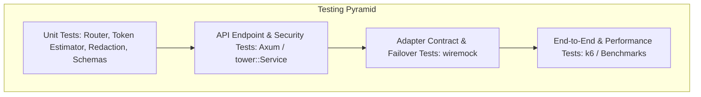

# TESTING.md — Comprehensive Testing & Verification Strategy

**Project:** `ai-backend` (High-Performance, Security-Focused Rust AI Backend)  
**Governing Specification:** [`MASTER_SPEC.md`](file:///d:/Rust%20Backend/ai-backend/MASTER_SPEC.md)  
**Status:** Complete Testing Framework Specification (Pre-Implementation Baseline)  
**Last Updated:** 2026-10-19

---

## 1. Testing Philosophy & Zero-Cost Test Fixtures

Testing AI backends requires rigorous validation without consuming expensive paid API quotas or exhausting scarce free-tier provider limits.

### Core Testing Rules
1. **Mocking by Default:** All automated CI integration tests must execute against local mock servers (using `wiremock`) simulating provider responses, headers, SSE chunks, and failure codes.
2. **Deterministic Routing Tests:** Task classification and model selection algorithms must be tested using deterministic prompt fixtures.
3. **No Network Leakage:** Automated unit and contract tests must never execute live outbound HTTP requests to external provider endpoints.
4. **Truth in Test Reporting:** Never report a test as passed unless the exact command was executed and exited with status code `0`.

---

## 2. Testing Layers & Scopes



### 2.1 Unit Tests (`src/**/tests.rs`)
- **Task Classifier Tests:** Assert that sample prompts ("Write Rust code...", "Draw a cat...", "Calculate eigenvalues...") correctly map to expected task categories and complexity tiers.
- **Model Registry Tests:** Query registry for specific modalities (e.g., `code`) and verify only compatible models are returned.
- **Secret Redaction Tests:** Verify that formatting configuration structs with `{:?}` never leaks secret strings.
- **SSRF Validator Tests:** Assert that IP addresses in `127.0.0.1`, `10.0.0.0/8`, `169.254.169.254`, and non-HTTPS schemes are immediately rejected.
- **Token Estimator Tests:** Verify heuristic token count approximations against known sample texts.

### 2.2 Integration Tests (`tests/api_tests.rs`)
- **Public Probes:** Test `GET /api/v1/health` and `GET /api/v1/ready` return HTTP 200 without authentication.
- **Auth Enforcement:** Assert that requests to `/api/v1/models` and `/api/v1/chat/completions` without auth headers return HTTP 401 Unauthorized.
- **Payload Limits:** Send a 5 MB payload to `/api/v1/chat/completions` and verify immediate rejection with HTTP 413 Payload Too Large.
- **Standardized Error Envelope:** Assert that 4xx/5xx responses adhere to the standard JSON error schema with valid `code` and `request_id`.

### 2.3 Provider Adapter Contract Tests (`tests/adapter_contracts.rs`)
Using `wiremock::MockServer`:
- **Successful Completion:** Verify request serialization and response parsing for OpenAI, Anthropic, and generic adapters.
- **Streaming SSE Parsing:** Simulate upstream chunked SSE transfer and verify canonical `StreamChunk` delivery to client.
- **Rate Limit (429) Handling:** Simulate HTTP 429 with `Retry-After: 5` header; verify adapter emits `ProviderError::RateLimited { retry_after_secs: Some(5) }`.
- **Upstream Timeout:** Configure mock delay of 15s; verify adapter cancels at 10s and emits `ProviderError::Timeout`.
- **Client Disconnect:** Verify that dropping the downstream test client connection aborts the upstream mock request.

### 2.4 Failover & Circuit Breaker Tests (`tests/failover_tests.rs`)
- **Automatic Fallback:** Configure Provider A to fail with 500 Internal Error; assert router automatically falls back to Provider B and successfully completes request.
- **Reporting Fallback:** Verify response metadata indicates `is_fallback: true` and names the initial requested model versus actual executing model.
- **Exhausted Options:** Simulate failure of all compatible models; verify response returns HTTP 502 with `UPSTREAM_FAILURE` without panicking.

### 2.5 Google Drive & Library Synchronization Tests (`tests/drive_sync_test.rs` & `tests/library_sync_test.rs`)
- **`tests/drive_sync_test.rs` (7 passing tests):**
  - `test_drive_switch_default_off_and_toggle`: Verifies sync is default disabled (`google_drive_sync_enabled: false`) and toggleable via `POST /api/v1/drive/config`.
  - `test_empty_account_initial_sync_and_local_conversation_upload`: Verifies first-time sync bootstrapping on an empty Drive account and local conversation upload.
  - `test_lww_conflict_resolution`: Verifies Last-Write-Wins (LWW) conflict resolution logic using remote vs local UTC timestamps.
  - `test_tenant_isolation_between_accounts`: Proves strict tenant isolation; Account A cannot view, restore, or decrypt Account B's conversation data.
  - `test_logout_preserves_remote_data_and_restore_recovers_it`: Proves logout clears local session but leaves remote Google Drive data untouched, and subsequent restore fully recovers history.
  - `test_http_429_rate_limiting_with_retry_after`: Verifies bounded retries, rate limiting handling, and RFC 9110 `Retry-After` delay honoring.
  - `test_transient_failure_retries_and_recovery`: Verifies automatic exponential backoff retries when Google Drive returns transient network errors.
- **`tests/library_sync_test.rs` (4 passing tests):**
  - `test_upload_and_download_library_item`: Verifies binary upload, SHA-256 checksumming, AES-256-GCM encryption, and raw octet-stream download.
  - `test_chat_deletion_leaves_library_items_intact`: Proves the critical lifecycle separation: soft-deleting a chat conversation NEVER deletes associated library files.
  - `test_path_traversal_sanitization`: Verifies directory traversal attacks (`../../etc/shadow`) are strictly sanitized to safe base filenames.
  - `test_library_sync_to_google_drive`: Verifies bidirectional sync of library metadata and content blobs to Google Drive `appDataFolder`.
- **Unit Tests in `src/drive/` (10 passing tests):**
  - Models: filename sanitization, RFC 3339 timestamps.
  - Crypto: AAD context binding, tampering detection, base64 roundtrip, AES-256-GCM roundtrip.
  - Local store: owner isolation, chat deletion independent lifecycle.
  - Mock client: file CRUD, error/transient failure injection.

---


## 3. Standard Verification Commands

Every development phase must pass the following quality gates:

```powershell
# 1. Formatting Check
cargo fmt --check

# 2. Compilation & Type Checking
cargo check

# 3. Automated Unit & Integration Tests
cargo test --all-targets

# 4. Strict Linter Rules
cargo clippy --all-targets --all-features -- -D warnings

# 5. Dependency Vulnerability Audit (in CI / release)
cargo audit
```

---

## 4. Performance Targets vs. Verified Results

Performance goals from [`MASTER_SPEC.md`](file:///d:/Rust%20Backend/ai-backend/MASTER_SPEC.md#L50-L64) are **engineering targets**, not verified measurements:

| Metric | Target Specification | Current Status | Verification Procedure |
|---|---|---|---|
| **Internal Routing Overhead** | < 10 ms (p95) | PROVISIONAL TARGET | Microbenchmark via `criterion` |
| **Metadata Endpoint Latency** | < 50 ms (p95) | PROVISIONAL TARGET | `k6` load test on deployed instance |
| **Model Registry Cached Query** | < 50 ms (p95) | PROVISIONAL TARGET | In-memory query microbenchmark |
| **Max Memory Usage** | < 64 MB under load | PROVISIONAL TARGET | MicroVM memory profiling |

No performance target will be marked as "ACHIEVED" without verifiable benchmark logs.
